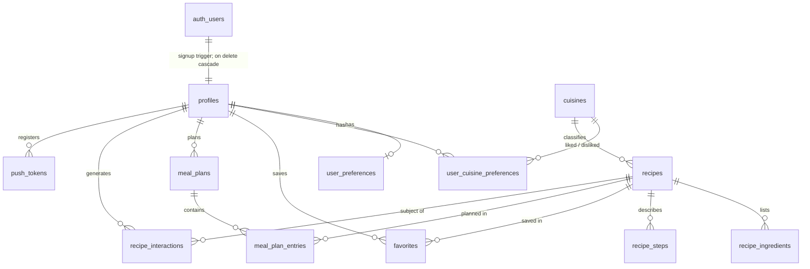

# SmartMeal — Data Model

Schema v1, from P13 (owner-approved 2026-10-23). Source of truth:
`supabase/migrations/`. This page explains the schema; when the two
disagree, the migrations win — fix this page.

Data classes (public, personal, sensitive personal) and retention are
defined in `docs/SECURITY.md` §3. In short: the catalog is public, every
user table is personal, and `user_preferences` holds sensitive personal
data (S6).

## Entity relationships

Every user table references `profiles(id) on delete cascade`, and
`profiles` references `auth.users(id) on delete cascade`. Deleting the auth
user therefore removes all of that user's rows (tested in
`supabase/tests/04_account_lifecycle.test.sql`). Storage objects do not
cascade: P14's Edge Function deletes `avatars/{uid}/…`.

## Tables

| Table | Purpose | Notes |
|---|---|---|
| `profiles` | One row per auth user | Created by `private.handle_new_user()` on `auth.users` insert (display name from Google `full_name`, trimmed, ≤ 80). `avatar_path` must sit in `{id}/…`. Defaults: `CM` / `XAF`. `setup_completed_at` is P15's gate |
| `user_preferences` | Setup answers (P16) | Sensitive. Allergy, diet and health values require `sensitive_data_consent_at` (CHECK). `allergens_declared` separates "none" from "not answered". Budget in whole XAF, amount and period set together |
| `cuisines` | Lookup | `slug` key; grows over time, so a table, not an enum |
| `user_cuisine_preferences` | Like / dislike per cuisine | |
| `recipes` | Catalog | Clients see `is_published` rows only. `allergens` never null (empty = none of the listed allergens). GIN indexes on `allergens` and `dietary_tags` for filters |
| `recipe_ingredients`, `recipe_steps` | Recipe detail | Visible when the parent recipe is published. `quantity` null = "to taste" |
| `favorites` | Saved recipes | Insert only for published recipes |
| `meal_plans` | One per user per ISO week | `week_start` is a Monday. No update: delete and recreate |
| `meal_plan_entries` | Slots in a plan | Carries the plan's `week_start` through a composite foreign key, so `plan_date` is checked to fall in the plan's week |
| `recipe_interactions` | Learning signal (P17) | Append-only for clients. `rating` is required for `rated` and forbidden otherwise. Kept 12 months (owner, 2026-10-23): pg_cron job `purge-expired-recipe-interactions` runs `private.purge_expired_interactions()` daily at 03:17 UTC |
| `push_tokens` | FCM tokens (P19) | Written only through `register_push_token(token, platform)`, which moves a token to whoever registers it last (shared devices) |

## Vocabularies

Postgres enums: closed sets, values may be **added** (`alter type … add
value`), never removed or renamed.

| Type | Values |
|---|---|
| `allergen` | gluten, crustaceans, molluscs, fish, eggs, milk, peanuts, tree_nuts, soy, sesame, celery, mustard, sulphites, lupin — one set for recipes **and** users, so the allergen filter is exact (S11). Groundnuts = `peanuts`; dried crayfish = `crustaceans` |
| `dietary_tag` | vegetarian, vegan, pescatarian, halal, gluten_free, dairy_free, low_carb |
| `health_goal` | lose_weight, maintain_weight, gain_muscle, eat_healthier, manage_blood_sugar |
| `lifestyle` | student, working_professional, family, athlete |
| `cooking_skill` | beginner, intermediate, advanced |
| `budget_period` | daily, weekly, monthly |
| `recipe_difficulty` | easy, medium, hard |
| `meal_slot` | breakfast, lunch, dinner, snack |
| `interaction_type` | viewed, favorited, unfavorited, planned, cooked, dismissed, rated |
| `push_platform` | android, ios |

## Access matrix

`anon` has **no** privilege on any table (tested). `authenticated` rows:
"own" means `(select auth.uid()) = user_id` (or `= id` on profiles), in
both `using` and `with check`. Writes are limited to listed columns, so
`id`, `user_id` and `created_at` never change after insert.

| Table | Select | Insert | Update | Delete |
|---|---|---|---|---|
| `profiles` | own | — (trigger) | own; display name, avatar, country, currency, onboarding/setup timestamps | — (P14) |
| `user_preferences` | own | own | own; all answer columns | own |
| `cuisines` | all | — | — | — |
| `user_cuisine_preferences` | own | own | own; `preference` | own |
| `recipes` | published | — | — | — |
| `recipe_ingredients`, `recipe_steps` | parent published | — | — | — |
| `favorites` | own | own, published recipe | — | own |
| `meal_plans` | own | own | — | own |
| `meal_plan_entries` | own plan | own plan, published recipe | own plan; date, slot, recipe, servings | own plan |
| `recipe_interactions` | own | own, published recipe | — | — (cascade, retention) |
| `push_tokens` | own | via `register_push_token` | via `register_push_token` | own |

The service role (Edge Functions, admin tooling) bypasses RLS and is the
only write path for the catalog.

## Functions

| Function | Security | Callable by | Why |
|---|---|---|---|
| `public.register_push_token(text, push_platform)` | definer, `search_path = ''` | authenticated | Reassigning a token updates another user's row, which RLS forbids the caller. Always writes `auth.uid()` |
| `private.handle_new_user()` | definer, `search_path = ''` | trigger only | The auth service has no rights on `public.profiles` |
| `private.set_updated_at()` | invoker | trigger only | `updated_at` maintenance |
| `private.purge_expired_interactions()` | invoker | pg_cron (postgres) | 12-month retention |
| `public.note_account_deletion_attempt(uuid)` | invoker | service_role only | P14 rate limit (5 per user per rolling hour) for the `delete-account` Edge Function; counters in `private.account_deletion_attempts`, swept after a day |

## Edge Functions

| Function | Caller | What it does |
|---|---|---|
| `delete-account` | signed-in user, signed in ≤ 10 min ago | Deletes `avatars/{uid}/…`, push tokens, then the auth user (cascade). See `docs/SECURITY.md` §11 |

`private` is not exposed through the Data API, and `authenticated` / `anon`
have no usage on it.

## Storage

| Bucket | Access | Limits |
|---|---|---|
| `recipe-images` | Public read (public URLs); no client writes | jpeg / png / webp, 5 MB |
| `avatars` | Private; authenticated users have full CRUD in `{uid}/…` only | jpeg / png / webp, 5 MB |

## Seed

`supabase/seed.sql`: 6 cuisines and 12 published recipes (Ndolé, Eru, Achu,
Koki, Poulet DG, Mbongo tchobi, jollof, puff-puff and four international).
Local only. Prices are placeholders for the owner to validate; images are
null so the app shows its fallback.
